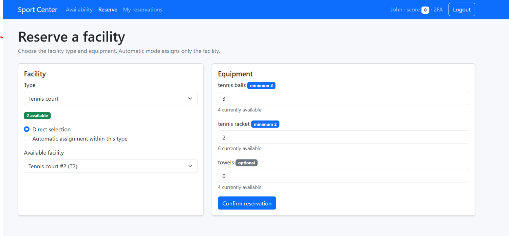

# Sport Facility Reservation System

A full-stack web application developed for a university Web Applications assignment. It manages sports facility reservations, equipment availability, and authenticated user workflows.



## Technologies

- **Frontend:** React, Vite, React Router, React Bootstrap
- **Backend:** Node.js, Express, REST API, Passport.js sessions
- **Database:** SQLite
- **Security:** Password authentication, TOTP-based second-factor authentication, server-side input validation

## Features

- Public view of sports facilities, availability, and equipment inventory
- Login and optional TOTP verification for demo users
- Direct facility selection or automatic assignment by facility type
- Create, view, edit, and delete reservations
- Track reserved equipment and enforce facility-specific equipment rules
- Enforce booking constraints, including re-booking cooldowns and score-based limits
- Session-authenticated REST endpoints and server-side request validation

## Running locally

Prerequisites: Node.js and npm. Start the backend and frontend in **separate terminals**.

**Backend (terminal 1)**

```bash
cd server
npm install
npm run init-db
npm start
```

By default, the API runs at `http://localhost:3001`. `npm run init-db` initializes the SQLite database with demo users and example reservations. Re-running initialization resets the demo data.

**Frontend (terminal 2)**

```bash
cd client
npm install
npm run dev
```

Open the local address shown by Vite (typically `http://localhost:5173`).

### Demo accounts

This project uses **fictional demo accounts only**, created by the initialization script:

| Username | Password |
| --- | --- |
| `u1@p.it` | `pwd1` |
| `u2@p.it` | `pwd2` |
| `u3@p.it` | `pwd3` |
| `u4@p.it` | `pwd4` |

For optional TOTP testing, the database initialization command prints a freshly generated demo TOTP seed for each account. Configure the corresponding seed in an authenticator app. These accounts and passwords are demonstration fixtures and must **not** be used in a real deployment.

### Security notes

- The local SQLite database is deliberately excluded from version control. Create it using `npm run init-db`.
- To keep authenticated sessions valid across server restarts, provide a strong, private `SESSION_SECRET` environment variable before starting the server. Otherwise the demo server uses a fresh random secret on each start.
- Do not deploy the sample users, development settings, or in-memory session storage in production.
- This is a university coursework project, not a production-hardened application.

## Project structure

```text
client/         React/Vite frontend and REST API client
server/         Express routes, data access layer, DB initialization
img/            Application screenshot
README.md       Project overview and setup instructions
.gitignore      Local secrets, databases, dependencies and build output
```

## API overview

- `GET /api/public` — public facility and equipment status
- `GET /api/reservations` — authenticated user's reservations
- `POST /api/reservations` — create a reservation
- `PUT /api/reservations/:id` — update reserved equipment
- `DELETE /api/reservations/:id` — cancel a reservation
- `POST /api/sessions` — log in
- `POST /api/login-totp` — verify second factor
- `GET /api/sessions/current` — current session
- `DELETE /api/sessions/current` — log out


